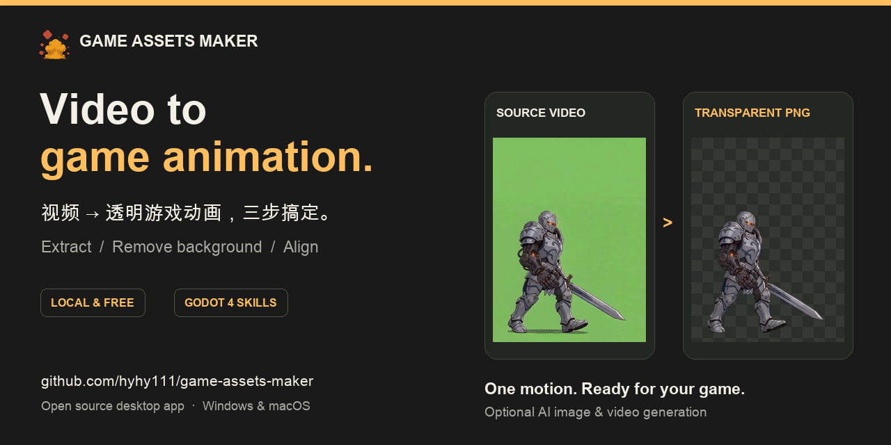

<div align="center">

# Game Assets Maker

**视频 → 透明游戏动画，三步搞定。**

**Video → game-ready animation, in three steps.**

[](https://github.com/hyhy111/game-assets-maker/releases/latest) [](LICENSE) [](https://github.com/hyhy111/game-assets-maker/releases/latest)

[下载 / Download](https://github.com/hyhy111/game-assets-maker/releases/latest) · [官网 / Website](https://forfunerai.com) · [GAM Skills](https://github.com/hyhy111/gam-skills) · [反馈 / Issues](https://github.com/hyhy111/game-assets-maker/issues)

[中文](#中文) · [English](#english)

</div>



*同一组真实动画帧，去背景前后同步播放，10 FPS 循环预览。 / The same animation frames before and after background removal, playing in sync at 10 FPS.*

---

## 中文

Game Assets Maker（GAM）是一款开源桌面工具，面向独立游戏开发者，将视频处理为透明 PNG 动画帧序列。已有视频可以直接开始；需要创作新角色或动作时，也可以使用内置的 AI 图片 / 视频生成。

**本地抽帧、去背景、对齐和裁剪免费，无需登录或购买积分。AI 生成按所选服务计费。**

[下载安装](#下载安装) · [使用说明](#使用说明) · [Agent 与 Godot](#agent-与-godot) · [常见问题](#常见问题) · [开发与部署](#开发与部署)

### 实际能做什么

- **视频变动画帧**：抽帧 → 去背景 → 挖孔与对齐，逐步预览结果。
- **批量裁剪**：统一包围盒，或逐帧紧致裁剪并保存偏移 JSON。
- **细节修整**：描边、孤立像素清理、边缘优化、颜色替换；支持隐藏异常帧。
- **角色与动作管理**：按角色整理待机、行走、跳跃、攻击等动画，保存每步参数。
- **可选 AI 创作**：Seedream 图片生成与 Seedance 视频生成，支持 ForFuner AI 或自定义火山方舟 Key。
- **Agent 协作与 Godot 4**：通过 GAM Skills 编写提示词、操作客户端，并将帧序列、偏移和音效导入 Godot 4。

### 下载安装

普通用户下载安装包即可，**不需要安装 Python、Node.js 或克隆源码**。

当前安装包：**v1.0.1**。后续版本请查看 [最新 Release](https://github.com/hyhy111/game-assets-maker/releases/latest)。

| 系统 | 下载 | 安装方式 |
| --- | --- | --- |
| Windows x64 | [EXE 安装包](https://github.com/hyhy111/game-assets-maker/releases/download/v1.0.1/GameAssetsMaker-1.0.1-windows-x64-Setup.exe) | 运行安装器；缺少 WebView2 时按提示联网安装。 |
| macOS Apple Silicon（ARM64） | [DMG 安装包](https://github.com/hyhy111/game-assets-maker/releases/download/v1.0.1/GameAssetsMaker-1.0.1-macos-arm64.dmg) | 打开 DMG，将应用拖入 Applications。 |

目前未提供 Intel Mac 或 Linux 安装包。macOS 包尚未签名或公证；若系统阻止打开，请按包内安装说明，在“系统设置 → 隐私与安全性”中选择“仍要打开”。校验文件 `.sha256` 见 [Release 附件](https://github.com/hyhy111/game-assets-maker/releases/latest)。

### 使用说明

#### 1. 准备素材

打开 GAM，在动画库创建角色 / 动作项目并导入视频。建议第一次先用一段短动作，走通流程后再批量制作。

**当前去背流程针对均匀、纯色的亮绿色背景优化。** 非绿底素材的背景与内部孔洞清除效果不保证；主体含相近绿色时也可能被误删。先检查素材背景、角色轮廓和动作完整性。

没有视频时，可先在“图片生成”准备角色图，再在“视频生成”中以角色图为首帧生成动作视频；AI 配置见下方说明。

#### 2. 三步处理

| 步骤 | 怎么操作 | 重点检查 |
| --- | --- | --- |
| **01 帧提取** | 选择起止帧、帧提取间隔，点击“开始提取”。 | 起势和收招是否完整，循环是否顺畅。 |
| **02 背景移除** | 首次按提示选择来源并下载 U2Net 模型（约 176 MB），再运行去背景。 | 头发、武器、细线和半透明边缘。 |
| **03 挖孔与对齐** | 清理手臂、武器之间的残留绿底；按动作需要启用水平居中或底部对齐。 | 是否误删主体绿色、跳跃高度或有意位移是否被改变。 |

每步完成后先播放检查。步骤 02 / 03 可隐藏异常帧，也可恢复；重新抽帧会使下游旧处理结果失效。模型就绪后，本地处理可以离线进行。

#### 3. 裁剪与导出

在“批量裁剪”中选择动画：

- **统一包围盒**：各帧使用相同画布尺寸，便于直接播放帧序列。
- **逐帧紧致裁剪**：缩小每帧透明边缘，同时保存 `_frame_data.json`；导入引擎时应保留偏移，避免角色抖动。

完成后从结果页打开输出目录，取得 PNG 帧序列及相关 JSON。有音效时间线时一并保留 `_audio_timeline.json` 与音频文件。Godot 4 导入可使用下方的 `gam-export` Skill；其他引擎需自行配置帧序列与偏移。

#### 可选：配置 AI 生成

| 方式 | 准备 | 费用来源 |
| --- | --- | --- |
| **ForFuner AI** | 在 GAM 注册并登录，在生成页面选择 ForFuner AI。 | 平台积分；提交前查看当前预计消耗。 |
| **自定义 Key** | 在火山方舟开通对应模型，在 GAM 设置中填写并保存自己的 API Key。 | 自己的火山账户，以官方用量和账单为准。 |

两种方式分别鉴权和结算。仅做本地处理无需配置；Key 连接检查通过不代表每个模型都已开通。模型、规格和费用以当前生成页面及服务方信息为准。

### Agent 与 Godot

六个 [GAM Skills](https://github.com/hyhy111/gam-skills) 可帮助 Agent 编写提示词、操作客户端、处理素材，并将动画导入 Godot 4。安装工具需要 Node.js/npm；选择对应命令安装全部六个 Skills：

```bash
# Codex
npx skills add hyhy111/gam-skills -g -a codex --skill "*"

# Claude Code
npx skills add hyhy111/gam-skills -g -a claude-code --skill "*"

# 自动检测并选择其他 Agent
npx skills add hyhy111/gam-skills -g --skill "*"
```

| Skill | 用途 |
| --- | --- |
| `gam-pic-prompt` | 编写角色图片提示词，明确视角与画风。 |
| `gam-video-prompt` | 根据角色图编写待机、行走、攻击等动作提示词。 |
| `gam-workflow` | 安排素材制作步骤，检查结果并继续处理。 |
| `gam-guide` | 查询功能、参数及账号与 API Key 配置。 |
| `gam-cli` | 通过 `gam-agent` 填写草稿、查询任务和操作客户端。 |
| `gam-export` | 将 PNG 动画帧、裁剪偏移和音效导入 Godot 4。 |

安装后可直接描述需求，例如“用 gam-pic-prompt，帮我写一个侧视剑士的图片提示词”，或“用 gam-export，把这个素材目录导入我的 Godot 4 项目”。

操作客户端前请先安装并打开 GAM，并允许 Agent 访问本地文件和执行命令。安装包自带 `gam-agent`，固定入口见 [开发与打包](DEVELOPMENT.md#打包发行)。`gam-export` 另需 Python 3.10+，仅依赖标准库；导出时提供素材目录和 Godot 4 项目目录。本地素材处理无需登录，在线 AI 生成使用客户端中的账号或自定义 Key 配置。更多 Agent 的安装选项见 [Skills CLI 支持列表](https://github.com/vercel-labs/skills#supported-agents)。

### 常见问题

**必须使用 AI 或登录吗？** 不需要。已有视频可直接进入本地流程，下载好背景模型后可离线处理。

**项目和模型存在哪里？** 安装版默认使用用户目录 `~/.gam`（Windows 为 `%USERPROFILE%\.gam`）；项目和 AI 缓存目录可在设置中调整。更新前退出应用，再覆盖安装。

**能直接导出 Godot 场景吗？** 通过独立的 `gam-export` Skill 导入 Godot 4。它读取 GAM 的裁剪结果、逐帧偏移与音效，并生成资源和预览场景；这一步需要 Agent 与 Godot 项目目录。

**去背后有残绿、缺边或动画抖动？** 先检查源素材是否为均匀绿底，再检查去背景参数、挖孔强度和对齐开关。逐帧裁剪结果导入引擎时应应用偏移，不能只加载 PNG。

重命名、默认模型和更新提示的详细行为见 [使用参考](USAGE.md)。模型下载与路径见 [MODELS.md](MODELS.md)。遇到问题请到 [Issues](https://github.com/hyhy111/game-assets-maker/issues) 提供应用版本、系统 / 架构、操作步骤与脱敏截图。

### 开发与部署

源码开发、测试、模型准备、CLI、安装包构建和 Skills 子模块维护见 [DEVELOPMENT.md](DEVELOPMENT.md#中文)，贡献规范见 [CONTRIBUTING.md](CONTRIBUTING.md)。

---

## English

Game Assets Maker (GAM) is an open-source desktop tool for indie game developers. Turn videos into transparent PNG animation frames, or create new characters and motion with the optional built-in AI image / video generation.

**Local extraction, background removal, alignment, and trimming are free and require no login or credits. AI generation is billed by the selected service.**

[Download](#download) · [Usage](#usage) · [Agents and Godot](#agents-and-godot) · [FAQ](#faq) · [Development](#development)

### What you can make

- **Video to animation frames**: extract → remove backgrounds → clean holes and align, with previews at each step.
- **Batch trim**: use a shared bounding box, or tight per-frame crops with offset JSON.
- **Clean up details**: outlines, isolated-pixel cleanup, edge optimization, color replacement, and reversible frame hiding.
- **Organize characters and actions**: keep idle, walk, jump, and attack animations together with per-step settings.
- **Optional AI creation**: Seedream images and Seedance videos, using ForFuner AI or your own Volcengine Ark key.
- **Agents and Godot 4**: use GAM Skills for prompting, client control, and importing frames, offsets, and audio into Godot 4.

### Download

Install the desktop app. **No Python, Node.js, or source checkout is needed for normal use.**

Current installers: **v1.0.1**. Check the [latest release](https://github.com/hyhy111/game-assets-maker/releases/latest) for updates.

| Platform | Download | Installation |
| --- | --- | --- |
| Windows x64 | [EXE installer](https://github.com/hyhy111/game-assets-maker/releases/download/v1.0.1/GameAssetsMaker-1.0.1-windows-x64-Setup.exe) | Run Setup; install WebView2 online if prompted. |
| macOS Apple Silicon (ARM64) | [DMG installer](https://github.com/hyhy111/game-assets-maker/releases/download/v1.0.1/GameAssetsMaker-1.0.1-macos-arm64.dmg) | Open the DMG and drag the app into Applications. |

Intel Mac and Linux installers are not currently provided. The macOS package is unsigned and not notarized; if blocked, follow the included instructions in System Settings → Privacy & Security → Open Anyway. SHA-256 checksum files are available in the [release assets](https://github.com/hyhy111/game-assets-maker/releases/latest).

### Usage

#### 1. Prepare a video

Open GAM, create a character / action project in the animation library, and import a video. Start with one short action before processing a larger set.

**The current background-removal workflow is optimized for a uniform, solid bright green background.** Other backgrounds may leave residue or internal holes; green parts of the character may also be removed. Check the source silhouette and motion first.

If you need source material, create a character in Image Generation, then use that image as the first frame in Video Generation. See the AI setup options below.

#### 2. Process in three steps

| Step | Action | Check |
| --- | --- | --- |
| **01 Extract frames** | Choose the start, end, and extraction interval, then start extraction. | Complete motion and a clean loop. |
| **02 Remove background** | On first use, select a source and download U2Net (~176 MB), then process the frames. | Hair, weapons, thin lines, and soft edges. |
| **03 Clean holes and align** | Remove green areas between limbs and weapons; enable horizontal centering or bottom alignment when needed. | Green character details, jump height, and intentional movement. |

Play the result after each step. You can hide and restore unwanted frames in steps 02 / 03. Re-extracting frames invalidates older downstream results. Once the model is ready, local processing works offline.

#### 3. Trim and export

Select animations in Batch Trim:

- **Shared bounding box**: all frames keep the same canvas size for straightforward sequence playback.
- **Tight per-frame crops**: save space and retain offsets in `_frame_data.json`; apply them in your engine to prevent jitter.

Open the output directory from the results to get the PNG sequence and related JSON. Keep `_audio_timeline.json` and audio files when present. Use the `gam-export` Skill below for Godot 4; configure frame sequences and offsets yourself in other engines.

#### Optional: AI setup

| Source | Setup | Billing |
| --- | --- | --- |
| **ForFuner AI** | Register and sign in inside GAM, then select ForFuner AI on the generation page. | Platform credits; review the current estimate before submitting. |
| **Custom key** | Enable the required models in Volcengine Ark, then save your API key in GAM settings. | Your own Volcengine account and provider bill. |

The two sources have separate authentication and billing. Neither is required for local processing. A successful key check does not prove access to every model. Available models, options, and costs follow the current generation page and provider information.

### Agents and Godot

The six [GAM Skills](https://github.com/hyhy111/gam-skills) help agents write prompts, control the desktop app, process assets, and export animations to Godot 4. The installer requires Node.js/npm. Choose a command to install all six skills:

```bash
# Codex
npx skills add hyhy111/gam-skills -g -a codex --skill "*"

# Claude Code
npx skills add hyhy111/gam-skills -g -a claude-code --skill "*"

# Detect and choose another agent
npx skills add hyhy111/gam-skills -g --skill "*"
```

| Skill | Purpose |
| --- | --- |
| `gam-pic-prompt` | Write character image prompts with a clear viewpoint and art style. |
| `gam-video-prompt` | Write idle, walk, attack, and other motion prompts from a character image. |
| `gam-workflow` | Plan asset creation steps, inspect results, and continue processing. |
| `gam-guide` | Look up features, parameters, account settings, and API key configuration. |
| `gam-cli` | Use `gam-agent` to fill drafts, query tasks, and control the desktop app. |
| `gam-export` | Import PNG animation frames, trim offsets, and audio into Godot 4. |

After installation, describe your request, for example: “Use gam-pic-prompt to write an image prompt for a side-view swordsman,” or “Use gam-export to import this asset directory into my Godot 4 project.”

Install and open GAM before controlling the client, and allow your agent to access local files and execute commands. The app bundles `gam-agent`; see [Packaging](DEVELOPMENT.md#packaging) for its stable entry paths. `gam-export` also requires Python 3.10+ and uses only the standard library. Provide the asset directory and Godot 4 project directory when exporting. Local processing needs no login; online AI generation uses the account or custom key configured in the client. See the [Skills CLI supported agents](https://github.com/vercel-labs/skills#supported-agents) for other installation options.

### FAQ

**Do I need AI or an account?** No. Process an existing video locally; download the background-removal model once to work offline.

**Where is my data?** Installed builds default to `~/.gam` (`%USERPROFILE%\.gam` on Windows). Project and AI cache directories can be changed in settings. Quit the app before installing an update.

**Can I export a Godot scene?** The separate `gam-export` Skill imports trim results, frame offsets, and audio into Godot 4, creating resources and a preview scene. It requires an agent and a Godot project directory.

**Green residue, missing edges, or jitter?** Check the uniform green background, removal parameters, hole-cleanup strength, and alignment options. Apply the saved offsets when importing tight per-frame crops.

See [Usage reference](USAGE.md#english) for renaming, default models, and update behavior, or [MODELS.md](MODELS.md) for model downloads and paths. Report problems in [Issues](https://github.com/hyhy111/game-assets-maker/issues) with the app version, OS / architecture, reproduction steps, and redacted screenshots.

### Development

See [DEVELOPMENT.md](DEVELOPMENT.md#english) for source setup, tests, model preparation, CLI details, installer builds, and Skills submodule maintenance. Read [CONTRIBUTING.md](CONTRIBUTING.md) before contributing.

---

[MIT](LICENSE) © ForFuner
